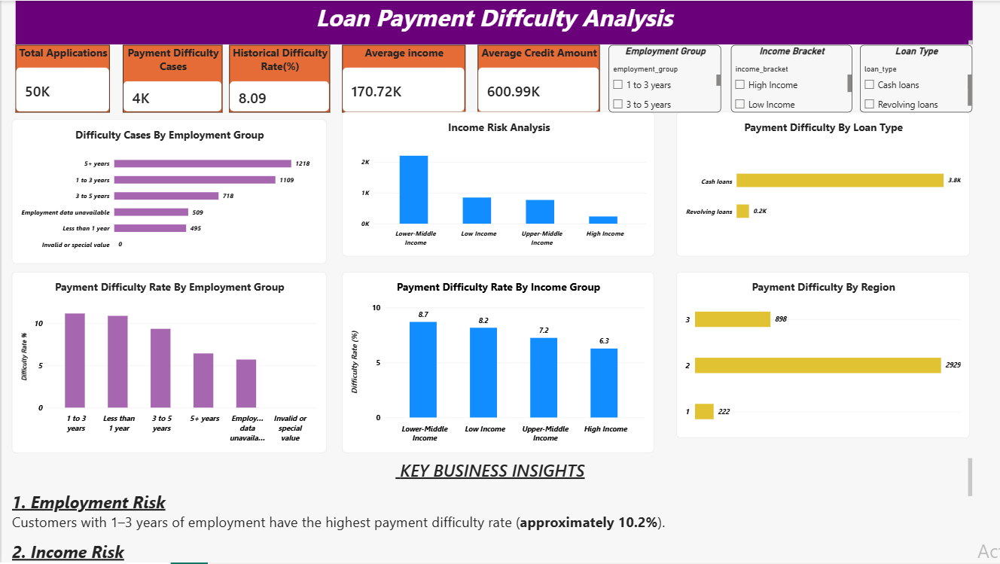

# Loan Payment Difficulty Analysis

## Dashboard Preview

## Project Overview

This project analyzes loan payment difficulty patterns across different customer segments to identify potential repayment risks and provide actionable business insights.

Using SQL, Python, and Power BI, the project explores how employment duration, income levels, loan types, and geographical regions relate to payment difficulty.

## Business Problem

Financial institutions need to understand which customer segments experience the highest payment difficulties.

The objective is to identify high-risk customer segments, understand repayment patterns, and help businesses make data-driven decisions.

## Business Objectives

- Analyze overall loan payment difficulty.
- Identify employment groups with higher payment difficulty.
- Compare payment difficulty across income brackets.
- Analyze payment difficulty by loan type.
- Identify regional differences in payment difficulty.
- Generate actionable business recommendations.

## Tools & Technologies
Tool/Purpose
SQL -> Data extraction and aggregation
Python -> Data exploration and analysis 
Power BI -> Interactive dashboard and visualization 

## Key Performance Indicators (KPIs)

- Total Applications: 50K
- Payment Difficulty Cases: 4K
- Historical Difficulty Rate: 8.09%
- Average Customer Income: 170.72K
- Average Credit Amount: 600.99K

## Key Business Insights

### 1. Employment Risk
Customers with 1–3 years of employment experience show the highest payment difficulty rate (approximately 10.2%).

### 2. Income Risk
Lower-middle-income customers have the highest payment difficulty rate (8.7%), followed by low-income customers (8.2%).

### 3. Loan Type Analysis
Cash loans account for the majority of payment difficulty cases compared with revolving loans.

### 4. Regional Analysis
Region 2 records the highest number of payment difficulty cases among the three regional categories.

## Power BI Dashboard

The dashboard provides a visual overview of:

- Difficulty Cases by Employment Group
- Income Risk Analysis
- Payment Difficulty by Loan Type
- Payment Difficulty Rate by Employment Group
- Payment Difficulty Rate by Income Group
- Payment Difficulty by Region

## Business Recommendations

1. Strengthen repayment assessment for customers with shorter employment histories.
2. Introduce additional repayment support for lower-income customer segments.
3. Investigate why cash loans contribute to the majority of difficulty cases.
4. Conduct deeper regional analysis to understand the factors behind higher difficulty cases.
5. Use customer segmentation to develop better repayment strategies.

## Project Outcome

This project demonstrates how SQL, Python, and Power BI can be used together to transform raw financial data into meaningful business insights.

The analysis helps identify customer segments experiencing payment difficulties and provides recommendations to support better financial risk management.

